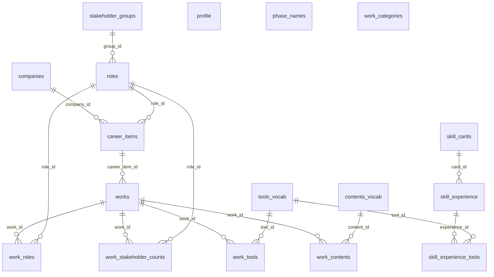

# ER 図(データ同士の関係図) — portfolio

生成日: 2026-11-06 / 出所: `src/types/supabase.ts` の外部キー定義(`referencedRelation`)。列名の詳細は同ファイル。
読み方: 四角がテーブル(データの箱)、線が「どの箱がどの箱を参照しているか」。`||--o{` は「1 件に対して複数件がぶら下がる」。

外部キーを持たないテーブル: `profile`(1 件固定)、`phase_names`、`work_categories`(works との対応は列で持つ。外部キー定義は未確認)。

## テーブル一覧

| テーブル | 役割(1 行) |
|---|---|
| profile | 本人プロフィール(名前・肩書き・自己紹介・顔写真) |
| career_items | 経歴の 1 行(会社 × 役割 × 期間) |
| companies / roles / stakeholder_groups | 経歴・作品で使う名前のマスタ(会社・役割・関係者グループ) |
| works | 作品。経歴の 1 行(career_item)にぶら下がる |
| work_roles / work_tools / work_contents / work_stakeholder_counts | 作品に付く役割・ツール・内容・関係者数(多対多の中間) |
| tools_vocab / contents_vocab | ツール名・内容名のマスタ |
| work_categories | 作品カテゴリ |
| skill_cards / skill_experience / skill_experience_tools | スキルカード → 経験 → 使ったツール |
| phase_names | 工程名のマスタ |

## 画面との対応

| 画面 ID | 読むテーブル | 書くテーブル |
|---|---|---|
| P01 トップ | profile, career_items, works(+categories), skill_cards 系 | — |
| P02 作品詳細 | works と中間 4 テーブル, roles, tools_vocab, contents_vocab | — |
| P05 管理セクション | 上記すべて | profile, career_items, works 系, skill 系, マスタ各種(save_work_with_relations / rename_* / set_* の関数経由) |
| P06 作品エディタ | works 系 | works 系(save_work_with_relations) |
